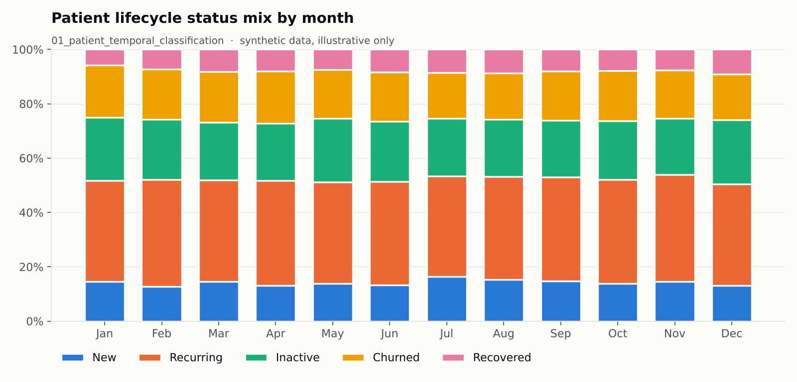
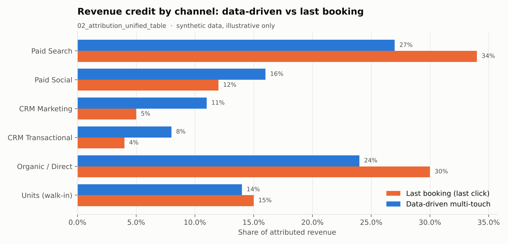
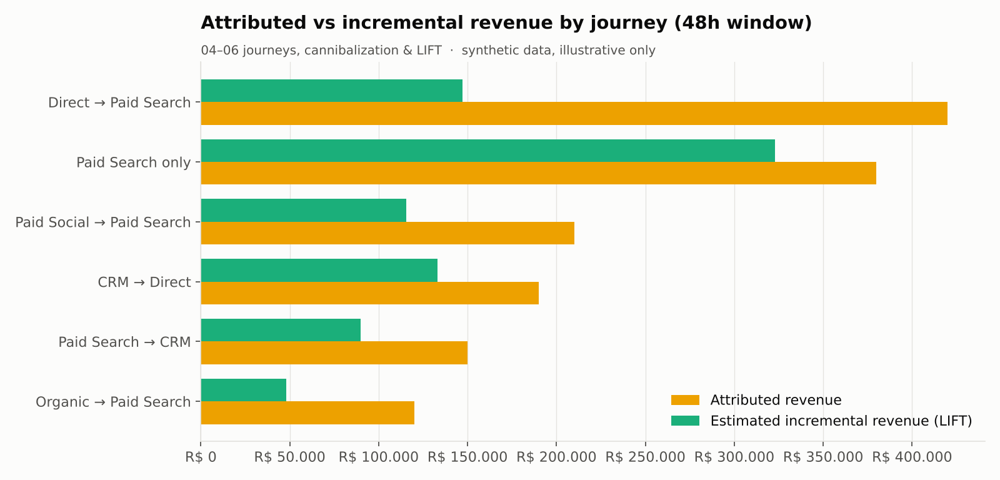
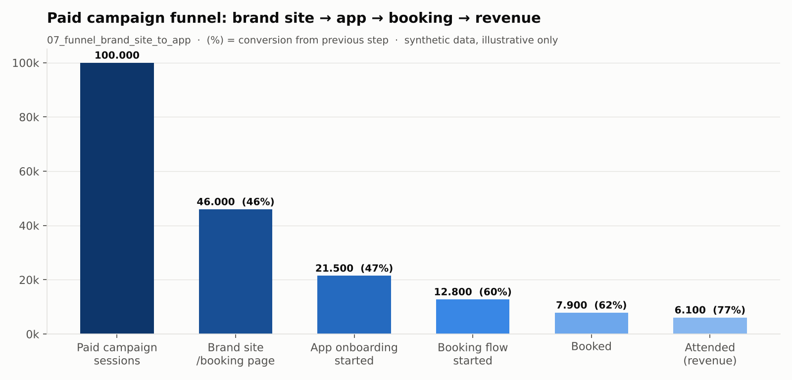

# 📡 Martech Analysis — Atribuição e Mensuração da Jornada do Paciente

> **Toolkit SQL end-to-end em BigQuery para classificação do ciclo de vida do paciente, atribuição multi-touch, canibalização entre canais e funis de conversão em uma grande empresa de diagnósticos de saúde.**

[🇺🇸 English](README.md) | 🇧🇷 Português

---

## Visão Geral

Este repositório reúne a camada SQL por trás da mensuração de marketing de uma empresa de diagnósticos multimarcas (Brasil). Ele responde três perguntas que relatórios de last-click não respondem:

1. **Quem é o paciente agora?** Novo, recorrente, inativo, churn ou recuperado — calculado mês a mês.
2. **Qual canal realmente merece o crédito pela receita?** Um modelo multi-touch data-driven comparado ao último agendamento.
3. **A mídia paga gera receita incremental ou só captura demanda que viria de qualquer jeito?** Sequenciamento de jornada, canibalização e LIFT.

> 🔒 Todos os nomes de projeto, dataset, marca e campanha foram anonimizados (`analytics-project`, `company-bi-prd`, `MARCA_01`…). Nenhum dado está incluído — apenas a lógica das queries.

---

## Problema de Negócio

Times de marketing em saúde multimarcas costumam olhar cada canal isoladamente e creditar a receita ao último toque antes do agendamento. Isso gera três pontos cegos:

| Ponto cego | Consequência | Como este repo resolve |
|---|---|---|
| Rótulo estático do paciente | Paciente que volta depois de 2 anos conta como "novo" e infla KPIs de aquisição | Classificação mensal com janela móvel (`01`) |
| Atribuição last-click | CRM e canais de topo de funil parecem não ter valor | Atribuição multi-touch data-driven com CRM como entidade própria (`02`, `03`) |
| Sem visão de incrementalidade | Paid search leva crédito por pacientes que já viriam pelo tráfego direto | Sequenciamento de jornada com `LEAD`, canibalização e fatores de LIFT (`04`–`06`) |

---

## Arquitetura

```
 Atendimentos / Agendamentos (DW)    Export GA4 + sessões do App      MDM de pacientes (CPF)
             │                                  │                             │
             ▼                                  ▼                             │
 ┌──────────────────────────┐        ┌────────────────────────┐               │
 │ 01 Classificação temporal│        │ Touchpoints por canal / │◄──────────────┘
 │    do paciente (loop)    │        │ subcanal / campanha     │
 └────────────┬─────────────┘        └───────────┬────────────┘
              │                                  │
              ▼                                  ▼
 ┌──────────────────────────────────────────────────────────┐
 │ 02 Tabela unificada de atribuição (data-driven x last AGD)│
 └────────────┬──────────────────────────────────────────────┘
              ▼
 ┌──────────────────────────┐   ┌───────────────────────────────┐   ┌──────────────────────────┐
 │ 03 View do dashboard     │   │ 04–06 Combinações de jornada,  │   │ 07–09 Funis: site → app   │
 │    (ordem do toque)      │   │ canibalização e LIFT           │   │ → agendamento → receita   │
 └──────────────────────────┘   └───────────────────────────────┘   └──────────────────────────┘
```

A tabela de classificação gerada pelo `01` também é a base do projeto complementar [**ltv-patient**](https://github.com/pedrougusto/ltv-patient) (coortes, curvas de LTV, CAC × LTV).

---

## Arquivos SQL

| # | Arquivo | O que faz | Técnicas-chave |
|---|---|---|---|
| 01 | `01_patient_temporal_classification.sql` | Loop mensal (2019 → hoje) que classifica cada paciente como novo / recorrente / inativo / churn / recuperado em 5 dimensões, numa janela de 24 meses | Scripting BigQuery (`DECLARE`, `WHILE`), tabelas temporárias, agregação condicional |
| 02 | `02_attribution_unified_table.sql` | Unifica atendimentos, agendamentos e touchpoints digitais e calcula atribuição **data-driven** x **último agendamento**, com CRM como entidade analítica | Peso `eficiência × proximidade` normalizado por atendimento (`peso_normalizado`) |
| 03 | `03_attribution_final_view_dashboard.sql` | View pronta para dashboard: ordem do toque (top 5), etapa por posição, receita por etapa, dias até a conversão | Agregação condicional, window function, view para BI |
| 04 | `04_journey_combinations_origin_time_lag.sql` | Combinações de jornada multicanal numa janela de 48h e time lag entre os passos | `LEAD`, sequenciamento de jornada, trava para jornada única |
| 05 | `05_journey_combinations_revenue_lift.sql` | Mesmas jornadas enriquecidas com receita, produtos e faixa etária, aplicando fatores de LIFT para estimar receita incremental | Fatores de incrementalidade, visão financeira + clínica |
| 06 | `06_cannibalization_campaign_mapping.sql` | O paciente agendou no passo 1 (ex.: direto) antes de clicar em paid search no passo 2? Mapeia campanhas e horários canibalizados | Cruzamento intra-jornada, timestamp do agendamento x clique |
| 07 | `07_funnel_brand_site_to_app.sql` | Campanha paga → site da marca → onboarding no app → etapas do agendamento → receita | Deduplicação de fan-out, reconciliação de granularidade exame → agendamento |
| 08 | `08_funnel_app_onboarding_to_revenue.sql` | Campanhas que levam direto ao app: funil de onboarding até a receita | Sessão como grão base, ponte agendamento ↔ sessão |
| 09 | `09_paid_search_post_login_analysis.sql` | Quanto do tráfego de paid search vem de pacientes já cadastrados (logaram antes ou no mesmo dia)? | Resolução de identidade cross-device (`user_pseudo_id` **ou** CPF) |

---

## Prévia dos Dashboards

> Gráficos gerados com **dados sintéticos** para ilustrar as saídas de cada query — não representam números reais da empresa.

| Mix de status do ciclo de vida (`01`) | Data-driven x último agendamento (`02`) |
|---|---|
|  |  |
| **Receita atribuída x incremental (`04`–`06`)** | **Funil site da marca → app → receita (`07`)** |
|  |  |

---

## Destaques Técnicos

- **Backfill em SQL procedural:** um único script reconstrói todo o histórico mensal, deixando a classificação auditável e reprodutível.
- **Disciplina de granularidade:** todo funil reconcilia explicitamente o grão (exame → agendamento → sessão) para evitar receita inflada por fan-out.
- **Resolução de identidade:** pacientes são ligados entre sessões deslogadas/logadas e dispositivos via MDM, não apenas cookies.
- **Incrementalidade acima de atribuição:** fatores de LIFT separam receita *atribuída* de receita *incremental*.

---

## Stack

| Camada | Tecnologia |
|---|---|
| Data Warehouse | Google BigQuery |
| Transformação | BigQuery Standard SQL + SQL procedural (scripting) |
| Web / App Analytics | Export GA4 → BigQuery |
| Identidade | MDM de pacientes (baseado em CPF) |
| Visualização | Looker Studio / Looker |

---

## Estrutura do Repositório

```
martech-analysis/
├── sql/
│   ├── 01_patient_temporal_classification.sql
│   ├── 02_attribution_unified_table.sql
│   ├── 03_attribution_final_view_dashboard.sql
│   ├── 04_journey_combinations_origin_time_lag.sql
│   ├── 05_journey_combinations_revenue_lift.sql
│   ├── 06_cannibalization_campaign_mapping.sql
│   ├── 07_funnel_brand_site_to_app.sql
│   ├── 08_funnel_app_onboarding_to_revenue.sql
│   └── 09_paid_search_post_login_analysis.sql
├── docs/
│   └── images/            # prévias dos dashboards (dados sintéticos)
├── LICENSE
├── README.md
└── README.pt-br.md
```

---

## So What?

- **Impacto no negócio:** o crédito sai de "quem foi o último" e vai para os canais que de fato constroem a jornada, e o budget de mídia paga para de pagar por demanda que chegaria organicamente.
- **Ação recomendada:** usar o `01` como fonte única de verdade do status do paciente, revisar o budget por canal com a atribuição data-driven e monitorar campanhas canibalizadas (`06`) antes de escalar paid search.

---

## Sobre

Desenvolvido por **Pedro Augusto** — Analytics Engineer com foco em Marketing Analytics, MarTech e Growth.
Os comentários nos SQLs estão em português (idioma original de trabalho); a documentação é bilíngue.
